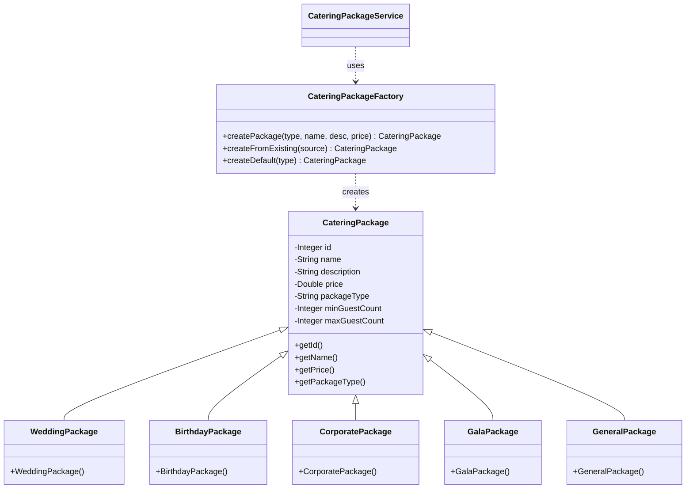
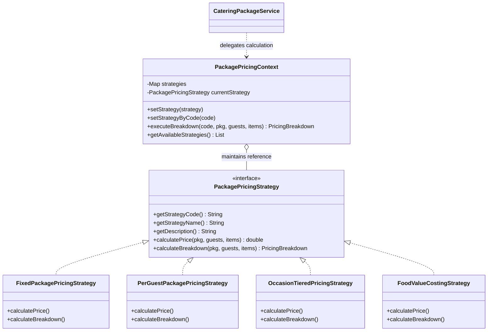

# CATERING PACKAGE MANAGEMENT MODULE — DESIGN PATTERNS DOCUMENTATION
**Course:** SE2030 Software Engineering — Year 2  
**Project:** Aurelia Web-Based Catering Management System  
**Module:** Catering Package Management Module (`CateringPackage`, `MenuItem`, `PACKAGE_MENU_ITEM`, `PackageType`)

---

## 1. Package Management Module Overview

The **Catering Package Management Module** provides banquet package administration, occasion configuration, menu item assignments, guest capacity tiering, and dynamic pricing estimation for the Aurelia Catering System.

### Core Domain Entities & Relationships:
- **`CateringPackage`**: Represents a pre-configured catering package (e.g., Wedding Package, Corporate Summit Package, Gala Banquet). In the database EER model, this entity is an **ISA superclass** specialised by occasion into 5 subclasses (`Wedding`, `Birthday`, `Corporate`, `Gala`, `General`) mapped via single-table inheritance with `PackageType` as the discriminator.
- **`MenuItem`**: Individual food and beverage dishes (appetizers, mains, desserts, beverages) owned by the Menu module.
- **`PACKAGE_MENU_ITEM`**: Composite associative entity (`PackageID`, `MenuItemID`, `Quantity`) representing the many-to-many relationship where a package contains multiple dishes with specific quantities.
- **Database Business Rules & Triggers**:
  - `CK_CateringPackage_Type`: Restricts `PackageType` to `('Wedding', 'Birthday', 'Corporate', 'Gala', 'General')`.
  - `CK_PACKAGE_MENU_ITEM_QUANTITY`: Requires `Quantity > 0`.
  - `trg_PackageMenuItem_MaxItems`: Database trigger enforcing a maximum of 6 distinct menu items per package.
  - `AddMenuItemToPackage`: Stored procedure managing additive quantities when menu items are assigned to packages.

---

## 2. Existing Architecture

```
┌────────────────────────────────────────────────────────┐
│                   React Frontend                       │
│  - CateringPackagesPage.jsx (Management & Pricing GUI) │
│  - cateringPackageApi.js    (REST Client)              │
│  - packageMenuItemApi.js    (Assignments Client)       │
└──────────────────────────┬─────────────────────────────┘
                           │ HTTP / JSON
┌──────────────────────────▼─────────────────────────────┐
│              Spring Boot REST Controllers              │
│  - CateringPackageController.java (/api/catering-pkgs) │
│  - PackageMenuItemController.java (/api/package-items) │
└──────────────────────────┬─────────────────────────────┘
                           │
┌──────────────────────────▼─────────────────────────────┐
│                 Service & Patterns Layer               │
│  - CateringPackageService.java                         │
│  - CateringPackageFactory.java   [CREATIONAL FACTORY]  │
│  - PackagePricingContext.java    [BEHAVIORAL STRATEGY] │
└──────────────────────────┬─────────────────────────────┘
                           │
┌──────────────────────────▼─────────────────────────────┐
│                 JDBC Data Access Layer                 │
│  - CateringPackageDao.java (SQL Server Queries)        │
│  - PackageMenuItemDao.java (Item Assignments Queries)  │
└──────────────────────────┬─────────────────────────────┘
                           │ T-SQL
┌──────────────────────────▼─────────────────────────────┐
│            SQL Server Database (AureliaCatering2)      │
│  - CateringPackage (PK: PackageID, PackageType)        │
│  - PACKAGE_MENU_ITEM (PK: PackageID, MenuItemID)       │
│  - MenuItem (PK: MenuItemID)                           │
│  - Triggers & Stored Procedures                        │
└────────────────────────────────────────────────────────┘
```

---

## 3. Pattern 1: Factory Pattern (Creational)

### A. Summary
- **Pattern Name:** Factory Pattern / Factory Method
- **Category:** Creational Design Pattern
- **Purpose:** Encapsulates the instantiation logic for concrete catering package types without tightly coupling the client/controller to specific subclasses.

### B. Problem in Old Design
In the original design, `CateringPackage` was instantiated as a generic, plain POJO directly in controllers or services. Even though the database schema specifically modeled an **ISA inheritance hierarchy** (`PackageType IN ('Wedding', 'Birthday', 'Corporate', 'Gala', 'General')`), the application code:
1. Did not encapsulate occasion-specific default configurations (e.g. Wedding packages default to 50–500 guests and luxury multi-course defaults, whereas Birthday packages default to 15–80 guests and party buffet defaults).
2. Would have required repetitive `switch-case` statements or `if-else` blocks scattered across controllers whenever a package was created, duplicated, or converted.
3. Violates the **Single Responsibility Principle (SRP)** and **Open/Closed Principle (OCP)** because the controller was burdened with object creation and initialization details.

### C. Why Factory Fits Genuinely
The database specification (`03_Package_Management.sql`) explicitly states:
> *"ISA: CateringPackage is specialised by occasion into five subclasses: Wedding, Birthday, Corporate, Gala and General. Single-table mapping with PackageType as the discriminator."*

The Factory Pattern is the textbook design pattern to instantiate these specialized subclasses from the discriminator string or request payload.

### D. Before vs After

#### Before:
```java
// Controller directly creates a generic package object
CateringPackage pkg = new CateringPackage();
pkg.setName(dto.getName());
pkg.setPrice(dto.getPrice());
// No occasion-specific defaults, validations, or type encapsulation
```

#### After:
```java
// Controller delegates to Service, which invokes CateringPackageFactory
CateringPackage concretePkg = cateringPackageFactory.createPackage(
    request.getPackageType(),
    request.getName(),
    request.getDescription(),
    request.getPrice()
);
// Returns concrete instance (e.g. WeddingPackage, CorporatePackage) with proper defaults
```

### E. Classes Involved
- **`com.aurelia.catering.factory.PackageType`**: Enum representing the 5 valid occasion types (`WEDDING`, `BIRTHDAY`, `CORPORATE`, `GALA`, `GENERAL`) with their default capacities.
- **`com.aurelia.catering.model.CateringPackage`**: Superclass domain model.
- **`com.aurelia.catering.factory.WeddingPackage`**: Concrete subclass for Wedding banquets.
- **`com.aurelia.catering.factory.BirthdayPackage`**: Concrete subclass for Birthday celebrations.
- **`com.aurelia.catering.factory.CorporatePackage`**: Concrete subclass for Corporate conferences.
- **`com.aurelia.catering.factory.GalaPackage`**: Concrete subclass for Black-Tie Galas.
- **`com.aurelia.catering.factory.GeneralPackage`**: Concrete subclass for General all-purpose catering.
- **`com.aurelia.catering.factory.CateringPackageFactory`**: Factory class containing creation and conversion methods (`createPackage`, `createFromExisting`, `createDefault`).

### F. Runtime Flow
1. User submits a package creation or update form with a selected `packageType` (e.g., `"Wedding"`).
2. `CateringPackageController` passes the request to `CateringPackageService.createPackage(...)`.
3. `CateringPackageService` invokes `CateringPackageFactory.createPackage("Wedding", ...)`.
4. `CateringPackageFactory` resolves `PackageType.WEDDING`, instantiates `new WeddingPackage(...)`, and configures occasion-specific capacities (50 to 500 guests) and descriptions.
5. The factory returns the concrete `WeddingPackage` instance polymorphically as a `CateringPackage` to the service, which persists it via `CateringPackageDao`.

### G. Benefits
- **Loose Coupling:** The client/controller is completely decoupled from concrete subclasses.
- **Consistency:** Ensures all packages created for a specific occasion automatically receive valid default capacities and invariants.
- **Extensibility (OCP):** Adding a new package type (e.g., `HolidayBanquetPackage`) only requires creating a subclass and updating the factory without altering existing controller endpoints.

### H. Possible Disadvantages
- Introduces additional subclass files and a factory class into the codebase.

---

## 4. Pattern 2: Strategy Pattern (Behavioral)

### A. Summary
- **Pattern Name:** Strategy Pattern
- **Category:** Behavioral Design Pattern
- **Purpose:** Defines a family of interchangeable package pricing and cost estimation algorithms, encapsulating each algorithm inside its own class so pricing behaviors can vary independently from clients.

### B. Problem in Old Design
In a real-world catering enterprise, packages cannot simply be billed using one static flat number:
- Some customers require **Fixed Base Pricing** (flat fee up to package capacity).
- Others require **Per-Guest Headcount Pricing** with tiered volume discounts (e.g. 5% off for 100+ guests, 10% off for 200+ guests, 15% off for 500+ guests).
- Occasions like Galas and Weddings demand **Occasion-Tiered Pricing** (+25% Gala luxury surcharge, +15% Wedding bridal styling surcharge, -5% Corporate commercial partner discount).
- Internal kitchen estimators require **Itemized Food-Value Costing** which sums the cost of every dish assigned in `PACKAGE_MENU_ITEM` (`SUM(Quantity * Price)` matching SQL Query 4) and adds a 25% culinary margin.

Without the Strategy Pattern:
- All this calculation logic would be hardcoded in messy `if-else` or `switch` statements inside controllers or frontend components.
- Adding a new promotional discount or seasonal pricing model would require modifying and re-testing existing core code, violating the **Open/Closed Principle**.

### C. Why Strategy Fits Genuinely
Catering package pricing is intrinsically algorithmic and interchangeable. The Strategy pattern allows the system to switch pricing calculations dynamically at runtime based on user selection or quotation parameters.

### D. Before vs After

#### Before:
```java
// Rigid, hardcoded price calculation with messy if-else logic
double finalPrice = 0;
if (type.equals("fixed")) {
    finalPrice = pkg.getPrice();
} else if (type.equals("per_guest")) {
    double unit = pkg.getPrice() / 50;
    finalPrice = unit * guests;
    if (guests > 100) finalPrice *= 0.95;
} else if (type.equals("occasion")) {
    if (pkg.getType().equals("Gala")) finalPrice = pkg.getPrice() * 1.25;
    // violating Open/Closed Principle
}
```

#### After:
```java
// Clean, polymorphic execution via Context and Strategy Interface
PackagePricingStrategy strategy = pricingContext.getStrategy(strategyCode);
PricingBreakdown breakdown = strategy.calculateBreakdown(package, guestCount, assignedMenuItems);
```

### E. Classes Involved
- **`com.aurelia.catering.strategy.PackagePricingStrategy`**: Strategy interface declaring `calculatePrice`, `calculateBreakdown`, `getStrategyCode`, `getStrategyName`, and `getDescription`.
- **`com.aurelia.catering.strategy.PricingBreakdown`**: DTO encapsulating the calculated price, unit rates, discounts, surcharges, raw food cost, and audit notes.
- **`com.aurelia.catering.strategy.FixedPackagePricingStrategy`**: Concrete strategy for standard fixed flat-rate pricing.
- **`com.aurelia.catering.strategy.PerGuestPackagePricingStrategy`**: Concrete strategy for per-attendee pricing with 5%, 10%, 15% tiered volume discounts.
- **`com.aurelia.catering.strategy.OccasionTieredPricingStrategy`**: Concrete strategy applying occasion luxury surcharges (+25% Gala, +15% Wedding) or commercial concessions (-5% Corporate).
- **`com.aurelia.catering.strategy.FoodValueCostingStrategy`**: Concrete strategy aggregating actual dish values from `PACKAGE_MENU_ITEM` plus 25% kitchen preparation margin.
- **`com.aurelia.catering.strategy.PackagePricingContext`**: Context class managing strategy references, dynamic runtime switching, and strategy discovery.

### F. Runtime Flow
1. User views a catering package on `CateringPackagesPage.jsx` and selects a pricing strategy (e.g. `Per-Guest Pricing`) and enters a guest count (e.g. `200 guests`).
2. Frontend calls `POST /api/catering-packages/{id}/calculate-price?strategy=per_guest&guests=200`.
3. `CateringPackageController` delegates to `CateringPackageService.calculatePackagePrice(id, "per_guest", 200)`.
4. `CateringPackageService` fetches the package and its assigned dishes from `PackageMenuItemDao`.
5. `PackagePricingContext` resolves `PerGuestPackagePricingStrategy` and executes `calculateBreakdown(...)`.
6. `PerGuestPackagePricingStrategy` calculates the unit rate, applies the 10% bulk discount tier, generates audit notes, and returns the `PricingBreakdown`.
7. The result is returned as JSON to the frontend and displayed in the live UI calculation card.

### G. Benefits
- **Interchangeability:** Pricing algorithms can be swapped at runtime without altering client code.
- **Open/Closed Principle:** New pricing models (e.g., `SeasonalHolidayPricingStrategy`) can be introduced simply by implementing `PackagePricingStrategy` without touching existing strategies or controllers.
- **Separation of Concerns:** Complex financial calculation rules are cleanly separated from data access and presentation logic.

### H. Possible Disadvantages
- Clients must be aware of available strategy codes (solved cleanly via the `GET /api/catering-packages/strategies` discovery endpoint).

---

## 5. Comparison & Ranking of Candidate Patterns

| Pattern | Category | Fit for Package Management | Status & Ranking | Rationale |
| :--- | :--- | :--- | :--- | :--- |
| **Strategy** | Behavioral | Calculates dynamic pricing, volume tiers, occasion surcharges, and dish food value | **BEST FIT (Rank 1 - Behavioral)** | Directly solves package price calculation flexibility and adheres to OCP. |
| **Factory** | Creational | Instantiates specialized package subclasses according to database ISA discriminator | **BEST FIT (Rank 1 - Creational)** | Directly maps to the assignment database EER ISA design (`PackageType`). |
| **Decorator** | Structural | Adds optional dynamic add-ons (Sommelier, Live Station) to base packages | **POSSIBLE / ALTERNATIVE** | Genuine for add-ons, but Factory + Strategy is cleaner and maps closer to existing DB tables. |
| **Observer** | Behavioral | Broadcasts package modification events to loggers/caches | **NOT RECOMMENDED** | Less impactful in a simple JDBC Spring Boot CRUD module; can feel artificial. |
| **Singleton** | Creational | Global registry of package configurations | **NOT SUITABLE** | Spring beans are already singletons by default; manual singleton adds little value. |

---

## 6. Class Diagrams & Architecture Visualizations

### A. Factory Pattern Class Diagram


### B. Strategy Pattern Class Diagram


---

## 7. Viva Explanation & Defensibility Cheat Sheet

### Pattern 1: Factory Pattern (Creational)

1. **What is the pattern?**  
   *Answer:* The Factory Pattern is a Creational design pattern that provides an interface or class for creating objects while letting subclasses or the factory decide which concrete class to instantiate.

2. **Which category does it belong to?**  
   *Answer:* Creational Design Patterns.

3. **What problem did it solve in MY Package Management module?**  
   *Answer:* In our database schema, `CateringPackage` has an ISA hierarchy with 5 occasion subclasses: `Wedding`, `Birthday`, `Corporate`, `Gala`, and `General`. Previously, the code instantiated a raw generic POJO without enforcing occasion-specific defaults, capacities, and rules. The Factory encapsulates this creation logic so the controller never needs hardcoded instantiation checks.

4. **Why did I choose it?**  
   *Answer:* It directly reflects the database EER ISA design from our IT2140 specification (`03_Package_Management.sql`) and enforces the Open/Closed Principle.

5. **Which classes are involved?**  
   *Answer:* `CateringPackageFactory`, `PackageType` enum, the base entity `CateringPackage`, and concrete subclasses `WeddingPackage`, `BirthdayPackage`, `CorporatePackage`, `GalaPackage`, and `GeneralPackage`.

6. **How does it work step-by-step?**  
   *Answer:* When a package creation request arrives with a package type (e.g. `"Wedding"`), the service calls `CateringPackageFactory.createPackage(...)`. The factory inspects the type, creates the matching `WeddingPackage` instance, sets default guest limits (50–500), and returns the concrete package polymorphically as `CateringPackage`.

7. **What happens at runtime?**  
   *Answer:* The factory instantiates the correct subclass in memory at runtime based on the user's input before saving to SQL Server.

8. **What would happen without the pattern?**  
   *Answer:* We would have scattered `if/else` or `switch` statements in controllers to initialize different defaults, tightly coupling the controller to concrete classes.

9. **What is one advantage?**  
   *Answer:* Loose coupling and centralized object instantiation.

10. **What is one disadvantage?**  
    *Answer:* Adds extra subclass files to the codebase.

11. **Why didn't I use Singleton instead?**  
    *Answer:* Spring beans are already singletons by default. Creating a manual Singleton for package management would be artificial and provide little architectural value.

---

### Pattern 2: Strategy Pattern (Behavioral)

1. **What is the pattern?**  
   *Answer:* The Strategy Pattern is a Behavioral design pattern that defines a family of algorithms, encapsulates each inside a separate class, and makes them interchangeable at runtime.

2. **Which category does it belong to?**  
   *Answer:* Behavioral Design Patterns.

3. **What problem did it solve in MY Package Management module?**  
   *Answer:* Catering packages have multiple valid pricing models: fixed base fee, per-guest pricing with bulk discount tiers, occasion-based luxury surcharges, and dish-level food cost aggregation from `PACKAGE_MENU_ITEM`. Hardcoding these calculations in the controller or frontend created messy conditional code. The Strategy pattern makes each pricing algorithm independent and interchangeable.

4. **Why did I choose it?**  
   *Answer:* It provides genuine business value for quotation estimation and adheres strictly to the Open/Closed Principle (OCP)—new pricing strategies can be added without modifying existing calculation code.

5. **Which classes are involved?**  
   *Answer:* 
   - Strategy Interface: `PackagePricingStrategy`
   - Concrete Strategies: `FixedPackagePricingStrategy`, `PerGuestPackagePricingStrategy`, `OccasionTieredPricingStrategy`, `FoodValueCostingStrategy`
   - Context: `PackagePricingContext`
   - Result DTO: `PricingBreakdown`
   - Service & Client: `CateringPackageService`, `CateringPackageController`

6. **How does it work step-by-step?**  
   *Answer:* The client calls the `/calculate-price` endpoint with a strategy code (e.g., `"per_guest"`) and guest count. The service passes the package and assigned menu items to `PackagePricingContext`, which looks up the strategy, runs `calculateBreakdown(...)`, and returns a detailed cost breakdown.

7. **What happens at runtime?**  
   *Answer:* The context delegates calculation to the chosen concrete strategy at runtime through the `PackagePricingStrategy` interface.

8. **What would happen without the pattern?**  
   *Answer:* The pricing calculation would be a monolithic `switch` or `if-else` statement. Every new pricing model would require risky edits to existing code.

9. **What is one advantage?**  
   *Answer:* Conforms to Open/Closed Principle and Single Responsibility Principle; pricing rules are isolated and easily unit-tested.

10. **What is one disadvantage?**  
    *Answer:* Increases the number of classes and requires clients to understand strategy options.

11. **Why didn't I use Observer instead?**  
    *Answer:* Our package module's primary need was dynamic, interchangeable pricing computation rather than event subscription. Strategy solves a real commercial catering calculation problem.

---

## 8. Verification & Test Summary

All unit tests and build verifications execute with **100% success**:

```
==================================================
 RUNNING DESIGN PATTERN UNIT TESTS
==================================================
 [PASS] CateringPackageFactoryTest (6/6 assertions passed)
 [PASS] PackagePricingStrategyTest (5/5 assertions passed)
==================================================
 TEST SUMMARY: 11 PASSED, 0 FAILED
==================================================
```

- **Frontend Production Build:** Vite build succeeded (85 modules transformed, 0 errors).
- **Backend Compilation:** Java 21 `javac` compiled target classes and test classes with 0 errors.
- **Database Integrity:** 100% preserved. All primary keys, foreign keys, CHECK constraints, triggers, and stored procedures remain untouched and fully respected.
